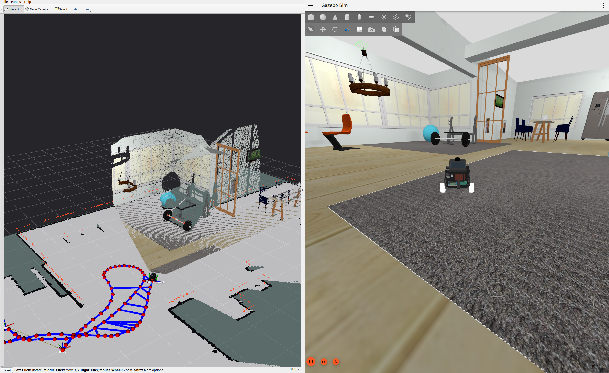

# Open PiRobot Simulation

A ROS 2 Jazzy and Gazebo Harmonic integration test bench for **Open-PiRobot**. It brings the project's ROS submodules together in a simulated robot: joystick or WASD teleoperation, encoder/IMU sensor fusion, SLAM Toolbox, and RViz. The modules remain reusable components; this repository provides the robot model, simulated sensors, and launch setup needed to exercise them together.



## Download

Clone the repository and its ROS submodules:

```bash
git clone --recurse-submodules <repository-url>
cd Open-PiRobot_simulation
```

The Docker workflow requires Docker with Compose. GUI runs require an X11/XWayland display. NVIDIA rendering also requires the host NVIDIA driver and NVIDIA Container Toolkit.

## Quick start

Build the simulation image and launch with keyboard control:

```bash
./scripts/sim.sh build --docker
./scripts/sim.sh up --docker --gpu nvidia --teleop keyboard
```

Hold **W/S** to drive forward/backward and **A/D** to turn. **Space** stops immediately; releasing a key stops the robot after the configured timeout. Press **Ctrl-C** in the terminal to shut down.

For a joystick, run:

```bash
./scripts/sim.sh up --docker --gpu nvidia --teleop joystick
```

Hold **L1** while moving the sticks. Use `--gpu none` for software rendering without NVIDIA.

## Configuration

[`config/simulation.yaml`](config/simulation.yaml) contains the simulation defaults: world and spawn pose, sensor and motor settings, ROS topics, SLAM and sensor-fusion modules, teleoperation, camera following, and Docker options. The RViz view is in [`config/simulation.rviz`](config/simulation.rviz). Module-specific ROS parameters remain in each module's `sandbox/*/config/` file and are referenced by the main YAML.

Robot meshes and materials have one source in `robot_asset/meshes/`; editable CAD and STL files are in `robot_asset/editable/` and `robot_asset/stl/`. `robot_descriptor` installs those meshes directly for URDF/Xacro, without a second asset copy. Edit the robot description in `src/robot_descriptor/descriptor/`, then rebuild:

```bash
./scripts/sim.sh build --docker
```

You can disable GUI windows or joystick input with ROS launch arguments, for example `gui:=false rviz:=false joystick:=false`. See [`docs/simulation.md`](docs/simulation.md) for the extended operating guide.

## Repository layout

```text
config/                  shared simulation configuration and RViz view
robot_asset/             source meshes, materials, and CAD files
scripts/                 project launch and management scripts
src/robot_descriptor/     robot URDF/Xacro and description publisher
src/simulation_bringup/   Gazebo, sensor, SLAM, and teleoperation launch
sandbox/                  ROS submodules exercised by the simulation
docker/                   Docker image definitions
interfaces/               robot ROS messages and services
docs/                     extended documentation
tests/                    simulation checks and helper tools
```
